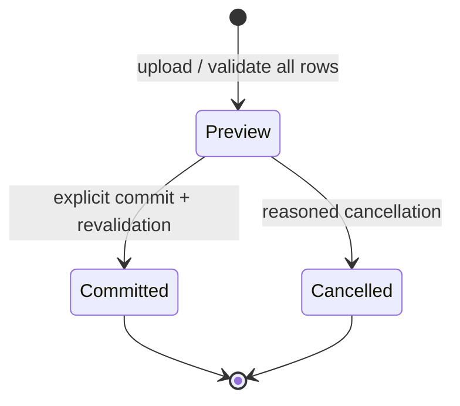
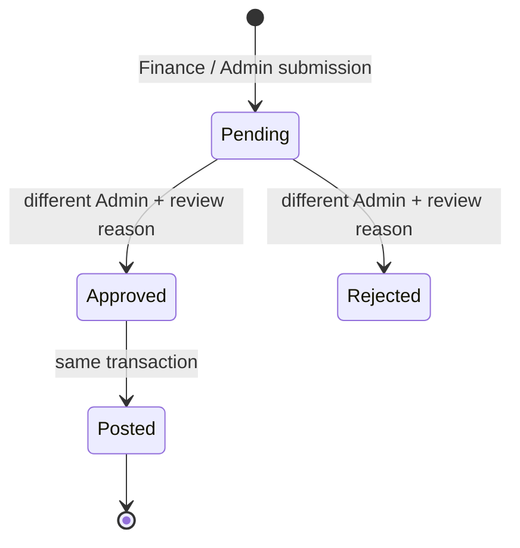
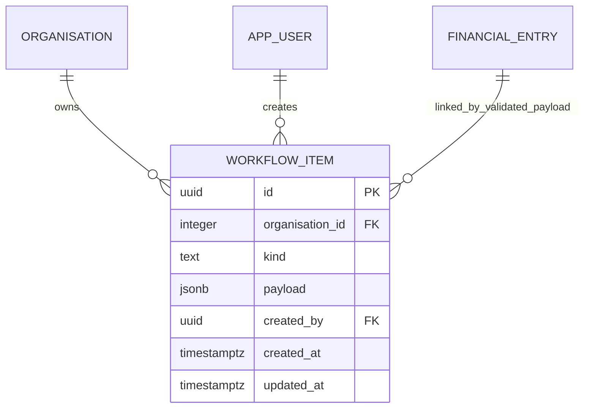

# Swizton finance application — v0.2 operations edition

This release extends the original P&L application with complete operational workflows around its financial engine. It remains a single-organisation system for Swizton Dubai. The private legacy workbook is a source of evidence, not approved postings. Original source figures remain preserved pending Finance review, RBI rates remain unapproved until supplied, and invoice dates remain separate from recognition periods.

## Working screens and workflows

| Screen           | What works                                                                                                                                                                                             |
| ---------------- | ------------------------------------------------------------------------------------------------------------------------------------------------------------------------------------------------------ |
| Overview         | Monthly Swizton revenue, expense, net result, cases/target, source mix and source links                                                                                                                |
| Profit & Loss    | Jan–Dec Actual/Approx, Actual FY total, working outlook, prior-year balances and Combined; Excel and PDF output                                                                                        |
| Revenue & bills  | CSH/IMH net shares, Al Garhoud component regimes, effective rates, recorded deduction amounts with reasons, forecast payout chain, receipts and approval requests                                      |
| Expense ledger   | Currency conversion, accrued/paid attributes, covered-month amortisation, source-currency outstanding balance and optional case-linked costs                                                           |
| Marketing wallet | Opening + additions − spend = closing; spend recognition, explicit cost behaviour                                                                                                                      |
| Analytics        | Source-line Approx/Actual variance, hospital/procedure ranking and matrix, case-linked costs, shared-cost allocation and classified fixed-cost breakeven                                               |
| Budget planner   | Multi-procedure count/revenue scenarios; quick projections                                                                                                                                             |
| Operations       | Row-by-row import previews, explicit atomic commit/cancel, independently approved adjustments, immutable named budget versions and comparison with Actual                                              |
| Receivables      | Original invoice and recognition dates, ageing buckets, collection history, remaining balance, professional-fee accruals and doctor payments                                                           |
| Workbook review  | Private XLSX inspection, source hash/version, preserved source-layout download, source-row check counts, observed monthly statement and filterable formula/feeder exceptions and sheet/error inventory |
| Masters          | Guided forms for hospitals, doctors, procedures, staff, expense heads, cost classification, effective share rules/component matrices, approved FX, targets and historical balances                     |
| Month close      | Readiness blockers/warnings, pending-adjustment check, locked period protection and Admin reopen with reason                                                                                           |
| User access      | Admin-managed named accounts, roles, password resets and immediate deactivation and session revocation                                                                                                 |
| Audit trail      | Append-only changed-record evidence, actor identity, reasons and pagination through older events                                                                                                       |

Source tables have search and 50-row pagination. Source drill-down shows the **allocated contribution** to the selected period/row, including FX and prepaid recognition, before showing the original source records. An annual prepaid's invoice amount is not misrepresented as its one-month expense.

## Business controls

### Import state machine



A preview does not insert ledger entries. Invalid rows expose their validation messages. A batch with any errors cannot commit. Commit checks revision, period locks, duplicates and master rules again inside the same transaction. Retrying an already committed batch cannot post a second copy. The older `/api/import/bills` endpoint remains available for compatible operator integrations; it still validates and commits its entire batch atomically. The browser uses the review workflow.

### Adjustment state machine



The submitter cannot review their own request. Pending requests have no financial effect and block month close. Both stale revisions and locks acquired after submission are rechecked at approval. Direct posting of an adjustment through the ordinary entry API is rejected.

An adjustment may change a source revenue/expense amount, or explicitly change **Chinmay's eligible-revenue basis** for a configured eligible source. The latter multiplies the signed basis adjustment by the effective doctor-pool and Chinmay rates; it changes the doctor allocation/residual without changing source revenue, Swizton revenue or net profit. This supports documented exclusions from the workbook without embedding constants in formulas or approving their business reasons automatically.

### Collections and professional fees

- A hospital collection is linked to a bill and a unique allocation/reference. It reduces the doctor-fee/final-share receivable; it does not recognise revenue again.
- Collections cannot precede the invoice, exceed its remaining share, duplicate an allocation reference, or be posted into a locked collection month. Receivables use invoice ageing; their financial recognition month is shown separately.
- Doctor payments are linked to the accrued fee period, doctor and bank reference. They reduce accrued professional-fee payables; they do not reduce Swizton net profit a second time.
- Doctor payments cannot exceed the remaining accrued fee, duplicate a payment reference, occur in a locked cash month, or be posted as a future-period advance. Separate prepayment/refund/reversal workflows are not implied by an ordinary payment.
- Settlement obligations are rounded to AED cents; the P&L retains its higher-precision calculation values. Source-rate changes that would put collected bills or paid doctors into an over-settled position are rejected.
- A grouped remittance must use distinct allocation references per bill (for example a bank reference plus an allocation suffix). Automatic bank-statement matching and payment-provider execution are not part of this release.

### Masters after close

A future procedure, hospital or FX period can be added without reopening completed months, provided locked monetary results, KPIs and source-share facts remain identical. A master update that changes a closed financial result or an already settled obligation is rejected. Zero-value new procedure/hospital rows do not by themselves alter a closed result. Reopening a month requires Admin and a reason.

### Profitability and budgets

Expense heads may be Fixed, Variable or Unclassified; ad spend has an explicit classification. Additional case-linked ledger costs are attributed directly. Remaining shared expenses are allocated by recognised IP bill count. Consumables already deducted in a hospital's net-share calculation are not deducted again as case costs.

Fixed-cost breakeven is available only when relevant expenses are classified and per-case contribution is positive: `fixed monthly expense ÷ ((recognised IP Swizton revenue − variable monthly expense) ÷ recognised IP bill count)`, rounded upward. Unclassified costs produce a visible incomplete status, rather than a misleading breakeven number. OP/admin reimbursement income is excluded from the IP procedure ranking.

A saved budget records its input rows, month, fixed cost, name, version and original projected totals. Comparing with Actual uses that saved projection. A separate current projection deliberately recalculates with current effective masters and is labelled accordingly. Saving another same-name/month scenario creates another immutable version, rather than overwriting a past budget.

## Additional APIs

All routes inherit authentication. Writes require Finance/Admin except account management, master updates and adjustment review, which require Admin. Management remains read-only.

| Method | Route                                             | Purpose                                                                    |
| ------ | ------------------------------------------------- | -------------------------------------------------------------------------- |
| GET    | `/api/workflows`                                  | Saved operational items; restricted workflow kinds filtered for Management |
| POST   | `/api/imports/preview`                            | Validate CSV/XLSX rows without posting                                     |
| POST   | `/api/imports/:id/commit`                         | Revalidate and atomically post a valid preview                             |
| POST   | `/api/imports/:id/cancel`                         | Cancel an uncommitted preview                                              |
| POST   | `/api/adjustments`                                | Submit an adjustment request                                               |
| POST   | `/api/adjustments/:id/review`                     | Independent Admin approval/rejection                                       |
| GET    | `/api/receivables?asOf=YYYY-MM-DD`                | Hospital share balances, linked collections and ageing                     |
| POST   | `/api/settlements`                                | Record a bill-linked collection                                            |
| GET    | `/api/doctor-payables/:month`                     | Accrued professional fees, paid and outstanding                            |
| POST   | `/api/doctor-payments`                            | Record a fee-period-linked payout                                          |
| POST   | `/api/budgets`                                    | Save a named scenario version and original projection                      |
| GET    | `/api/budgets/:id/variance`                       | Saved budget versus current Actual                                         |
| POST   | `/api/workbooks/review`                           | Private source inspection; no ledger import                                |
| GET    | `/api/workbooks/:id/baseline`                     | Authenticated preserved-layout XLSX download                               |
| GET    | `/api/reports/drilldown`                          | Per-source recognised contribution for a P&L row                           |
| GET    | `/api/months/:month/readiness`                    | Blockers and warnings before close                                         |
| GET    | `/api/accounts`                                   | Admin account directory without password hashes                            |
| POST   | `/api/accounts`                                   | Admin create/update/reset/deactivate with audit reason                     |
| GET    | `/api/audit?before=sequence&limit=200&action=...` | Cursor-based full audit history                                            |

All financial/workflow mutations use the same organisation revision lock, so entries, workflow states and audit records commit together. A stale revision returns 409. Account updates use the same transaction/revision discipline and exclude password hashes/values from audit payloads. Authentication checks current role, active state and token version on each request, including for demo accounts. Password/access changes invalidate previously issued tokens; reactivating an account does not revive old sessions.

## Schema extension



The payload is discriminated as adjustment request, import batch, collection, doctor payment, budget or workbook review. Its logical source links are validated by the domain API. Run migrations when upgrading; the workflow table and allowed-kind constraint are updated idempotently. Existing financial entries remain append-only.

## Build and run

```sh
npm ci
npm run build
# Prepared app, with source data kept separate:
DEMO_MODE=true NODE_ENV=production npm start
```

`build/` contains JavaScript backend/operator tools and the migration DDL. `dist/` contains the React application. `npm start` does not require tsx. The compiled workbook processor is launched with a memory cap and timeout. The development runner remains available through `npm run dev`.

For production, supply `DATABASE_URL`, a random `JWT_SECRET` of at least 32 characters and `PRIVATE_DATA_DIR` through the hosting secret/environment manager. Use PostgreSQL mode, migrate, create the first named Admin, and configure approved rules/FX/targets. Workbooks are stored only under `PRIVATE_DATA_DIR` outside the checkout and are never placed in the static web root. The private directory must be writable only by the application service account and retained/backed up alongside the database. Demo mode rejects real workbook review uploads outside automated synthetic tests.

The compiler rewrites TypeScript import extensions, copies the schema to `build/db/`, and resolves the same actual project root for private-data path protection. Migrations can be run as `node build/scripts/migrate.js`; an operator with `NEW_USER_PASSWORD` securely supplied can use `node build/scripts/create-user.js email Role`. Do not run migration privileges in the ordinary web account.

## Validation and deployment boundary

- Engine, API and workflow tests cover money allocation, independent approval, revision conflicts, invalid/double import commits, cash-versus-recognition separation, overpayment, user deactivation, budget snapshots, source-layout preservation and audit immutability.
- PostgreSQL tests use a unique temporary schema and remove it afterward. Private golden tests require an external fixture path; the public CI never receives the source workbook or confidential financial values.
- Browser checks exercise every screen, receipt recognition, guided master editing/saving, calculations, drilldown and mobile overflow.
- `npm run test:packaged`, with a disposable `SWIZTON_TEST_DATABASE_URL`, starts the compiled JavaScript server in production/PostgreSQL mode, authenticates a synthetic Admin, runs the compiled private-workbook processor, downloads its protected baseline and verifies no ledger entries were posted.
- GitHub Actions runs the build, PostgreSQL integration tests, packaged-server checks and packaged-app browser checks. Private workbook fixtures are intentionally omitted there; that test is explicitly skipped in public CI.
- Workbook archive checks cap compressed/uncompressed sizes, entry count and expansion ratio, reject macro/external-link packages and prevent directory traversal. Imports require values instead of executable worksheet formulas.
- The known moderate advisories in ExcelJS's archive dependency chain remain a release-review item. Archive limits and the child-process boundary do not constitute a vendor patch or an independent security certification.

This release implements the application workflows. It does **not** claim the legacy statement is reconciled or that a live production service has been deployed. The following are still external prerequisites: approved RBI rates, Finance explanations/sign-off for source exceptions and contract terms, approved comparative balances, hosting/TLS/secrets, and tested database/private-file backup and recovery. VAT and Corporate Tax amounts remain disclosures; tax applicability, statutory calculation and filing need the accountant-approved policy. Bank execution, remittance reconciliation, refunds/reversals, SSO/MFA, large-volume database pagination and multi-tenant accounting are distinct extensions rather than silently simulated capabilities.
