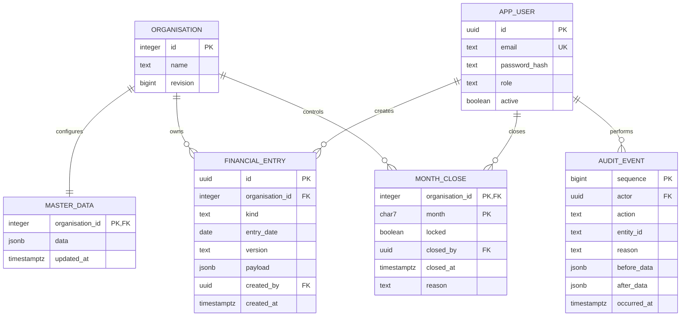

# Swizton Dubai finance system — delivery specification

Organisation: **NINETY EIGHT FAHRENHEIT MEDICAL SERVICES FZCO**. Calendar fiscal year Jan–Dec; functional currency AED; presentation INR lakh (100,000 INR).

## Delivered scope and acceptance boundary

The repository contains a working React/TypeScript interface, Node/Express API, PostgreSQL persistence, effective-dated financial engine, CSV/XLSX bill import, Excel/PDF exports, role-based logins, month control and append-only audit events. Demo mode is explicitly isolated in memory and resets on restart. Production mode never seeds transactions or rates.

**Exact reproduction of the source workbook has not been established.** A workbook has now been supplied and privately inspected; source exceptions and accounting approvals remain unresolved. See [the private reconciliation workflow](WORKBOOK_RECONCILIATION.md). Signed balances and approved rate tables remain outstanding. Tests use synthetic, independently calculated examples. Workbook-specific formulas, deductions and print formatting must pass the reconciliation gate below before the system replaces Excel.

## 1. Database schema and ERD

The executable DDL is [db/schema.sql](../db/schema.sql). PostgreSQL 16 is the tested target.



### Master data logical relationships

`master_data.data` has validated collections: hospitals (ID, name, net-share/components method), doctors, procedures, staff, expenseHeads (name → P&L category), rules (hospital → effective interval, component/regime rates, Swizton share, doctor pool, Chinmay share and eligibility, gross deductions), monthly FX, monthly targets and comparatives (year, P&L line, AED, INR lakh).

Each `financial_entry.payload` is a discriminated, validated record:

| Kind | Principal fields | Logical master relationships |
|---|---|---|
| bill | Date, hospital, invoice, patient reference, IP/OP, procedure, doctor, cash/insurance, gross, consumables, pharmacy/lab, regime, component amounts, VAT/tax disclosure, visits | hospital, procedure, doctor, effective share rule |
| estimate | Date, centre/hospital, patient, contact, procedure, referral, payment, approval, consumables fraction, visits | hospital, procedure, effective share rule |
| receipt | Date, OP Consultation/Admin Cost Reimbursement, amount, patient, visits | effective source rule |
| expense | Date, head, amount, currency, Actual/Accrual, paid state, remarks, optional covered dates | head → category; monthly FX |
| wallet | Date, opening/topup/spend, AED amount, reference | Marketing Expense on spend only |
| adjustment | Date, source P&L line, signed AED, mandatory reason | effective source rule when revenue |

JSONB is an intentional MVP storage choice for variable hospital components and configurable master collections. Zod and domain validation enforce logical relationships within the same serialised transaction; the database enforces IDs, kind/date/version agreement, invoice uniqueness and users. It is **not** a fully normalised accounting subledger or multi-tenant system. If direct SQL writers/integrations are introduced, normalise masters and postings and add database foreign keys first. Decimal values are strings in JSON, avoiding binary float storage; computation uses Decimal.js.

All financial writes lock the organisation revision row. Optimistic revisions reject stale writes with HTTP 409. Master/input changes, close/reopen and audit insertion commit atomically. Inputs are append-only; corrections use reasoned source adjustments. Editing/deleting bills is intentionally absent. Audit snapshots currently copy the full dataset; production scale should move to entity-level deltas plus durable transaction IDs and encrypted retention.

### Role matrix

| Capability | Admin | Finance | Management |
|---|---|---|---|
| View dashboard, reports, sources, exports, budget scenarios | Yes | Yes | Yes |
| Create entries/import bills/view audit | Yes | Yes | No |
| Configure masters | Yes | No | No |
| Close month | Yes | Yes | No |
| Reopen month | Yes | No | No |

Production users have bcrypt passwords and one-hour signed JWTs. Active state and role are rechecked against PostgreSQL on every request. Initial users are created by an operator CLI, not a public registration endpoint. Tokens are held in browser session storage; TLS, identity-provider SSO/MFA and secure HttpOnly sessions are recommended production extensions.

## 2. API list

All `/api` routes except login and health require `Authorization: Bearer <token>`. JSON errors use `{error}`; stale revisions return 409, denied roles 403, expired/absent authentication 401, validation 400. Login is rate limited in-process (10 failures / 15 minutes per IP). Shared limits and reverse-proxy policy are deployment work.

| Method | Endpoint | Request / result |
|---|---|---|
| GET | `/api/health` | Process/database readiness; demo flag |
| POST | `/api/auth/login` | `{email,password}` → `{token,user,demo}` |
| GET | `/api/me` | Current authorised user |
| GET | `/api/data` | `{data:{masters,entries,closes},revision,demo}` |
| GET | `/api/pnl/:year` | 12 Actual/Approx periods, Actual FY, working outlook, three prior-year comparatives, Combined |
| POST | `/api/entries` | `{entry,reason,revision}`; create validated source record |
| POST | `/api/import/bills` | `{format:'csv'|'xlsx',content,reason,revision}`; CSV text or base64 XLSX; atomic batch, 1–1000 rows, UI 5 MB cap |
| PUT | `/api/masters` | `{masters,reason,revision}`; full collection replacement; Admin only |
| POST | `/api/months/:month/close` | `{locked,reason,revision}`; close or Admin reopen |
| GET | `/api/audit` | Latest 200 audit snapshots; Finance/Admin |
| GET | `/api/analytics/:month` | Source-line variance, hospital/procedure ranking, case-cost allocation, indicative breakeven |
| POST | `/api/budget` | `{month,fixedCost,items:[{hospital,procedure,cases,revenuePerCase}]}` → projected Swizton revenue/profit; no ledger mutation |
| GET | `/api/export/:year/xlsx` | Monthly Approx/Actual × AED/INR lakh/%; FY, comparatives, combined, KPI/mix rows |
| GET | `/api/export/:year/pdf` | A3 monthly report pages and annual/comparative summary |

Drilldown uses `rows[line].ids` from the report and source records returned by `/api/data`; values are always calculated on the server. The MVP loads all organisational data into memory per request; pagination and a dedicated drilldown endpoint are required at production volumes.

## 3. Screen wireframes

Implemented screens follow these layouts. The working UI is the interactive wireframe; desktop and narrow-width layouts are provided.

```text
┌────────────────────┬─────────────────────────────────────────────────────┐
│ swizton healthcare │ Organisation                         [FY 2026 ▼]     │
│ Dubai Finance      │ Overview                                            │
│                    │ [Sample-data banner when demo mode is enabled]      │
│ Overview           │ [Jun 2026 ▼] [Open/Locked] [Actual | Approx]         │
│ Profit & Loss      │                                                     │
│ Revenue & bills    │ [Revenue] [Expenses] [Net P/L] [Cases / Target]      │
│ Expense ledger     │ [Monthly profit trend]       [Revenue composition]  │
│ Marketing wallet   │ [Revenue / share waterfall]  [Procedure mix]        │
│ Analytics          │                                                     │
│ Budget planner     │ Every financial source figure → source record list │
│ Masters            ├─────────────────────────────────────────────────────┤
│ Month close        │ Financial operations · Role · Monthly FX translation│
│ Audit trail        │                                                     │
│ [Role / Sign out]  │                                                     │
└────────────────────┴─────────────────────────────────────────────────────┘
```

```text
P&L                  [Monthly | Yearly comparison] [AED / INR lakh / %]
                     [Excel ↓] [PDF ↓]
Sticky particulars | Jan Approx | Jan Actual | … | Dec Approx | Dec Actual
Total Revenue      | …
  Hospital/source  | …           click value → source transactions
Doctor shares      | …
Swizton Revenue    | …           100% base
Expense categories | …
NET PROFIT / LOSS  | …
Cases / Visits / Target / Achievement / Procedure mix
Yearly view: FY26 Actual | FY25 | FY24 | FY23 | Combined | Working outlook
```

```text
Input module           [+ Add record]       [CSV/XLSX import for bills]
Record type            bill / estimate / receipt / expense / adjustment
Context fields         Date, Hospital, Patient, Procedure, Doctor, Invoice
Financial fields       Gross, Deductions, Components / Currency / Coverage
Reason                 [Required audit explanation______________________]
                       [Save record]
Source ledger          Date | Kind | Reference | Patient/Remarks | Amount
Expense ledger         Monthly amortisation | Outstanding | Source currency
Marketing wallet       Opening | Additions | Spend | Closing
```

Other screens: Masters displays collection tabs and a validated JSON editor (Admin); Month close presents status, impact and required reason; Audit offers before/after snapshots; Analytics presents the hospital/procedure ranking and variances; Budget planner accepts multiple procedure-count assumptions.

## 4. Calculation contract and tests

The engine is [server/engine.ts](../server/engine.ts), domain validation [server/validation.ts](../server/validation.ts), analytics [server/analytics.ts](../server/analytics.ts). Monetary strings retain six decimal AED places and eight INR-lakh places in the API; reports display two places. Decimal arithmetic uses precision 32 and half-up rounding. Annual values sum monthly representations; sub-cent precision differences may arise from monthly representation and disappear at displayed cents. No rates are embedded in engine formulas. Sample rates exist only in demo fixtures and must be approved/replaced.

### Explicit financial assumptions needing workbook confirmation

1. **CSH/IMH**: `Net = Gross − Consumables − Pharmacy/Lab − Gross × adminRate − Gross × refundableRate`; `Final Share = Net × billShareRate`. Both 5% deductions use gross in the sample rule. Optional recorded `adminAmount`/`refundableAmount` with mandatory `deductionReason` override defaults independently. Source inspection shows that a uniform gross-based deduction is insufficient; contractual bases and whether refundable amounts are an asset/liability still require accountant confirmation.
2. **Al Garhoud**: `Revenue = Σ(componentAmount × rate[regime][component])`. Standard, HMS and Insurance-OP are separate rate tables; no silent fallback. Unspecified component rates cause an error. Demo zero rates on unspecified components are illustrative, not approved contractual terms.
3. **Approx** (confirmed source chain): `Net = Approval × (1 − consumablesFraction)`; `Doctor payout revenue = Net × (forecastShare ?? share)`; `Swizton revenue = Doctor payout revenue × swizton`. The UI labels approval as gross amount. Forecast doctor share is effective-dated master data and can differ for fee-for-service sources. The doctor-payout disclosure now agrees with the allocation base. Separate payable/settlement schedules are not yet implemented.
4. **Total Revenue** includes all hospital shares + admin reimbursement + OP receipts, not patient gross hospital billings. VAT/tax fields are informational amounts, with no automatic statutory tax calculation or tax ledger.
5. **Chinmay**: sum over eligible sources of `Revenue × doctorPool × chinmayRate`; eligibility is effective-dated per source. **Swizton**: sum per source of `Revenue × swiztonRate`. **Tahsin** is the residual. The default example is 70% × 20% and 30%; production rules start empty.
6. **Expenses**: each head maps to one of four P&L expense categories. HR includes corporate/centre staff, incentives, welfare; referral marketing uses a separately mapped marketing head. Paid/unpaid and Actual/Accrual are attributes, not duplicate postings or recognition switches. Do not enter the same cost twice as an accrual and payment; the payment settlement workflow is future work.
7. **Prepaid**: inclusive covered months; `perMonth = sourceAmount / coveredMonths`; O/S is source amount less recognised months. Mid-month dates count as full months (no day proration). Each recognition month's central FX applies to INR/USD expenses. Source-currency O/S is shown, not an FX-revalued balance-sheet carrying amount.
8. **FX**: one approved INR-per-AED and AED-per-USD rate per month. INR costs convert to AED at recognition-month rate; USD costs use AED-per-USD. Report INR lakh = AED × monthly INR-per-AED / 100,000. Annual INR is the sum of monthly INR, never multiplied by a separate annual rate. No RBI API ingestion is performed; Finance records rate and provenance centrally.
9. **Wallet**: one initial opening per version; prior inflows less spend roll forward, monthly topups increase wallet balance, monthly spend alone enters marketing expense. Negative balances are shown transparently and require Finance reconciliation; this is not a bank-payment authorisation service.
10. **Totals**: FY Actual is always Actual only (section 2 of request). **Working outlook** uses Approx for open months and Actual for locked months (section 4). Closing never adds Actual on top of Approx. Historical totals are supplied in both currencies and ratios use each year's Swizton AED base. Missing comparative cells and incomplete Combined values remain missing, not invented zero balances.
11. **KPIs**: IP bills are cases, OP bills/receipts contribute visits but not cases. A single IP bill corresponds to one procedure case. Explicit visits are additive; importers must avoid counting the same visit in both bill and receipt. No patient deduplication or encounter linking is implemented. Achievement is cases ÷ target; zero target and zero Swizton percentage denominator yield null.
12. **Manual adjustments** may alter a source revenue line or expense category only. Source revenue adjustments pass through the applicable shares. Derived totals cannot be typed over. KPI adjustments and direct postings to individual doctor shares need a separate approved design.
13. **Locks** cover both forecast and actual entries touching the month, including annual prepaids. All masters are frozen if any month is locked. Admin may reopen with reason. For the MVP, adding a future procedure or FX year also requires reopening; period-versioned snapshots will remove that operational constraint later.
14. **Profitability** currently allocates all monthly costs evenly per IP case and discloses this basis. A true fixed/variable-cost breakeven and procedure direct costs need explicit cost classifications. The implemented indicative breakeven uses total expense ÷ average Swizton revenue per case. Ranking is contribution after assumed allocation, not a verified clinical costing model.

### Validation evidence

The suite covers independently calculated synthetic examples and integration behaviour, not Excel golden results. Example: gross AED 10,000 − consumables 1,000 − pharmacy/lab 1,000 − admin 500 − refundable 500 = net 7,000. At 45%, final share = 3,150; Swizton 945, Chinmay 441, Tahsin 1,764. Annual license 21,100 / 12 = 1,758.33 displayed per month; opening-month O/S 19,341.67.

Run `npm test` for synthetic engine and in-memory API tests (database-only audit test skipped), or `SWIZTON_TEST_DATABASE_URL=<local PostgreSQL URL> npm test` for all tests. Database tests create and drop a uniquely named temporary schema. Do not provide production database credentials. Tests validate authentication, permissions, revision conflicts, close/reopen, prepaid lock coverage, atomic CSV import, XLSX input/output, PDF signature, missing-rate failures, share allocations, effective-date boundaries, FX translations, procedure metrics and audit immutability.

### Workbook reconciliation gate (source inspected, approvals pending)

Preserve an untouched source workbook; export all sheets with formulas and cached/displayed values. Capture signed FY26 monthly Actual/Approx cells and FY23–25 comparatives, FX rates and workbook print areas. Load the feeder transactions into a staging database, resolve the rule assumptions above, then add immutable golden fixtures with expected line/currency/month/version amounts. Compare every cell and KPI at workbook precision; do not accept aggregate-only matching. Replace typed `+2000`, `−2000−416` and similar embedded values with individually documented adjustments, linked to approval evidence. Require zero unexplained variance, accountant sign-off and print-layout approval before cutover.

## 5. Workbook migration plan

1. **Acquire and protect**: request the original FY26 workbook, prior-year totals, hospital contracts/share amendments, source invoices and approved RBI month rates through a secure channel. Retain read-only originals and SHA-256 hashes; restrict patient/contact access.
2. **Inventory**: catalogue feeder sheets, Excel dates/serials, formula cells, hidden rows, merged headers, hardcoded constants, workbook named ranges, duplicate invoice numbers and manual adjustments. Record original sheet/row coordinates in a migration reconciliation file.
3. **Map**: hospital names → stable IDs; doctor/procedure variants → masters; expense heads → HR/marketing/admin/finance; component labels → defined components; cash/insurance and IP/OP → enums. Capture effective-date changes and missing/unapproved rates as exceptions.
4. **Stage**: convert hospital bill dates to ISO strings and amounts to unsigned decimal strings; use `docs/bills-template.csv`. Build source-specific transformations outside the production ledger. Use CSV/XLSX bill upload for hospital invoices. For estimates, receipts, ledger and wallet use validated `/api/entries` batches via a migration script; the UI does not yet have bulk import for these kinds. Preserve reference mapping and totals outside the app.
5. **Separate recognition/cash**: recover wallet opening/additions/spend, prepaid coverage, paid/accrued costs. Remove duplicated accrual/payment rows only with documented Finance approval. Import opening wallet once per version.
6. **Load masters first**: approve source share rules, all 12 monthly FX rates and targets, procedure/doctor masters, head mapping, and original AED/INR-lakh comparative balances. Production migration seeds names/categories only; no sample rates are assumed approved.
7. **Dry run**: import to a separate test database, reconcile invoices and daily/monthly hospital totals, doctor shares, all P&L lines, percentage denominators, INR totals, wallet rollforward, prepaid O/S and case/visit counts. Reject entire invalid bill batches and correct source mappings, not computed outputs.
8. **Golden tests**: version approved expected monthly cells independently from input data. Document any unavoidable restatement caused by correcting annual FX (25 vs 26) separately from workbook-parity mode; one consistent FX rule means the software cannot simultaneously reproduce inconsistent old formulas without an explicit reconciliation bridge.
9. **Sign-off**: Finance approves each month's differences, Management approves annual/historical comparisons, Admin closes accepted months. Keep Excel and app in parallel through one month close; export and compare XLSX/PDF layouts.
10. **Cutover**: encrypt backups and test restoration, restrict database roles, assign named users, record migration batch IDs, freeze legacy workbook and record final hash. Rollback is read-only Excel continuation plus restore of pre-import database backup; no silent overwriting or deletion of signed financial history.

## 6. Phased roadmap

| Phase | Delivered baseline / next work | Exit criterion |
|---|---|---|
| MVP: inputs + P&L | Delivered application, engine, effective-date masters, role login, bills/estimates/receipts/expenses/wallet inputs, prepaids, locks/audit, bill import, XLSX/PDF exports. Remaining: workbook golden fixtures, payout schedule ambiguity, exact print layout, full feeder migration, per-head reporting and finer master forms. | Every monthly source and cell reconciled with signed workbook; migration approved; named-user PostgreSQL deployment passes recovery and permissions checks. |
| Analytics | Delivered variance, contribution ranking, hospital×procedure matrix and multi-procedure budget prototype. Next: fixed/variable cost classification, case-linked direct costs, cash/receivable views, complete YoY history and saved budget revisions. | Reconciled analytical dimensions and Finance-approved cost allocation/breakeven model. |
| Forecasting | Delivered simple case-count scenario calculator and Approx inputs. Next: conversion probabilities, lead pipeline, capacity/staff planning, scenario versions, forecast accuracy and rolling outlook snapshots. | Backtested assumptions with approved forecast ownership and monthly accuracy review. |
| Deployment hardening | SSO/MFA, TLS termination, secret management, audited account lifecycle, granular patient permissions, input/import resource isolation, shared rate limits, monitoring, backups, restore drills, dependency patching, independent access/security review. | Hosting, data retention and healthcare privacy controls approved; no open release blockers. |

VAT and UAE Corporate Tax fields are available as bill disclosures. Tax applicability, input-VAT recovery, statutory calculation and filing are not automated by this MVP; tax/accounting review must define the required postings and rates. No live patient data should enter demo mode.

### Dependency audit at delivery

`npm audit --omit=dev` reported 0 high/critical and 8 moderate advisories in the ExcelJS archive dependency tree (legacy minimatch and dependents). The direct CSV parser and the UUID dependency were updated to patched releases and revalidated. A forced major minimatch override would break the legacy glob API, so it was not applied blindly. Isolate untrusted spreadsheet processing and replace or upgrade this archive chain before production approval. This application is not represented as production-security certified.
