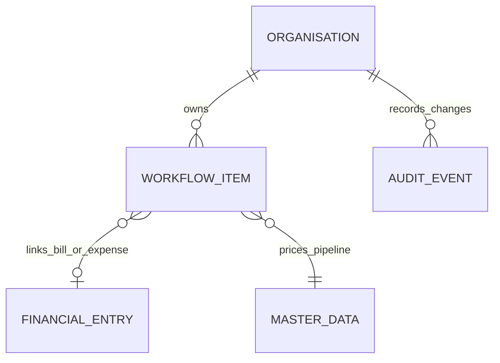

# Forecasting and cash planning — v0.3

This phase adds an audited planning workspace without posting forecasts to the P&L. Finance/Admin can maintain leads, capture forecasts and record cash events; Management can read, preview and export. The September source figures remain preserved pending Finance review. Monthly RBI rates still require approval; the app does not infer them from the conflicting workbook rates.

## Screens and workflow

```text
Planning
 ├ Procedure pipeline: stage board → new/edit lead → link Won to Actual IP bill
 ├ Rolling forecast: cutoff/horizon → monthly cost/capacity → preview → immutable version
 ├ Forecast accuracy: saved version → locked-month comparison → error / MAE / WAPE / bias
 └ Cash outlook: opening balance → dated plans → monthly liquidity → actual bank evidence
```

The lead board supports New, Qualified, Approved, Scheduled, Won and Lost, with hospital, procedure, owner/referral source, expected approval, deductions, probability, expected procedure date, optional separate recognition month and collection lag. Won requires a unique matching Actual IP bill for the same hospital and procedure. Won leads remain linked to Actual; repeat procedures require another lead. Lost/Won are excluded from pipeline projections. Overdue active leads must be rescheduled explicitly, rather than silently moving their revenue forward.

## Forecast calculation

For each active lead, the engine selects the effective hospital share rule on the expected procedure date:

```text
probability used = min(1, lead probability × probability sensitivity)
net approval = approval amount × (1 − material/deduction fraction)
final doctor-fee revenue per case = net approval × master forecast share × revenue sensitivity
weighted Swizton revenue = final doctor-fee revenue × master Swizton share × probability used
weighted cases = probability used, in the original expected procedure month
```

These are planning assumptions, not calibrated statistical confidence intervals. Each lead represents one procedure case. Al Garhoud uses its configured forecast share for this aggregate planning estimate; the Actual component-rate bill engine remains separate.

An open month combines Actual entries known by the selected cutoff with weighted pipeline revenue. Actual invoice/occurrence date determines whether it was known; recognition month determines revenue timing. A locked month uses its full Actual and excludes pipeline. Legacy Approx estimates are not added again. Finance must mark completed leads Won to avoid projecting a case already billed.

Monthly expense is the greater of known Actual expense and `fixed monthly cost + expected total cases × variable cost per case`. This is an explicit planning cost floor, not a new ledger expense. Capacity gaps are warnings; the engine does not discard excess demand or manufacture staffing capacity. Detailed staff scheduling is future work.

Approved monthly FX converts forecast Swizton revenue to INR lakh. If a future month has no approved FX and no Actual requiring conversion, AED forecasts remain available and INR is blank with a warning. Actual calculations requiring missing FX fail explicitly. No fallback exchange rate is invented.

## Frozen versions and accuracy

A saved forecast freezes its parameters, monthly output, master-rule IDs and share rates, lead approval/deduction/probability inputs, source revision, lead update timestamps and monthly FX evidence. Later edits cannot change it. Versions increment within forecast name and cutoff date; export downloads that frozen result rather than recalculating it.

Accuracy compares those frozen monthly outputs against currently locked Actuals. Rows are scored only when the cutoff equals the server's captured business date, the month was not already closed at capture, the snapshot was not captured retrospectively, and the month is now locked. Other rows are explicitly labelled unscored. Business date uses the configured application timezone (Asia/Calcutta).

Error is forecast minus Actual. MAE is mean absolute AED revenue error; WAPE is sum of absolute errors divided by sum of absolute Actual revenue; bias is the mean signed AED error. Zero-denominator percentage metrics remain blank. These metrics assess Swizton revenue; profit/case comparisons are shown per row. Reopening a month removes it from scoring until it is locked again. No accuracy claim is made for the synthetic demo.

## Cash timing and safeguards

The opening bank balance is supplied by Finance as of the **beginning of the cutoff day**, not inferred from revenue or profit. The first outlook bucket includes events from that day onward. This is an AED planning report, not a bank connection or automatic reconciliation service.

Recorded cash includes OP/Admin receipts, hospital settlements, professional-fee payments, expense payments, full paid expense amounts on their source date, marketing wallet top-ups, and explicit capital/financing movements. Prepaid amortisation and wallet advertising spend do not become additional cash outflows. Revenue recognition does not itself imply a hospital collection.

Finance can schedule an In plan against a bill, an Out plan against an unpaid expense or accrued doctor fee, or a separate capital/financing plan. Open linked plans reserve the remaining source balance. After other payments, outlook amounts are capped to the remaining obligation, preventing duplicate expected collections/payments. Overdue plans appear from the cutoff with a warning while retaining their original saved date.

Optional weighted pipeline cash estimates full final-share collections after the lead's collection lag, then combined professional-fee outflow after the configured doctor-payment lag. It uses current lead probabilities and master rules, not sensitivity multipliers from a saved revenue scenario. Separate doctor proportions are handled by the Actual accrual/payment workflows. Cash plans and pipeline figures are assumptions; they do not authorize payments or contact a bank.

Recording a confirmed bank movement atomically marks its cash plan Realized and creates the linked settlement, doctor payment, unpaid-expense payment or capital movement. A partial actual payment closes that plan; Finance can create another plan for the remaining obligation. Positive amounts, unique allocation references, source balances, transaction dates, role permissions, revision conflicts and closed cash months are checked. Audit evidence includes both plan changes and the created bank event. A realized plan cannot be realized twice. P&L revenue/expenses are not posted a second time.

Unpaid expense balances use the full source amount converted at its original transaction-month central FX, rounded to AED cents, minus linked cash payments. The original `paid` flag remains source evidence; derived balances show subsequent payments. Master changes cannot lower that book amount below recorded payments. This planning book value does not implement a statutory FX gain/loss ledger; settlement FX accounting and bank fees require an approved accounting policy.

## Persistence and ERD extension

Planning records use the existing organization-scoped `workflow_item` JSONB store and audited transaction/revision lock. The schema adds four permitted kinds:



`lead` holds pipeline inputs and optional Won bill link. `forecast_snapshot` holds immutable parameters, evidence and result. `cash_plan` holds expected timing, source obligation and realization metadata. `cash_movement` holds confirmed unpaid-expense or capital cash evidence. Existing `settlement` and `doctor_payment` records remain the cash sources for those obligations. Link validity is enforced transactionally by the application; JSON links are not database foreign keys.

## API additions

All routes require a valid user session. Writes require Finance/Admin, current organization revision and a reason of at least eight characters.

| Method | Path                          | Purpose                                                        |
| ------ | ----------------------------- | -------------------------------------------------------------- |
| POST   | `/api/leads`                  | Create a pipeline lead                                         |
| PUT    | `/api/leads/:id`              | Edit with revision and expectedUpdatedAt conflict checks       |
| POST   | `/api/forecasts/preview`      | Calculate without saving; Management allowed                   |
| POST   | `/api/forecasts`              | Capture an immutable version                                   |
| GET    | `/api/forecasts/:id/accuracy` | Locked-month accuracy against frozen output                    |
| GET    | `/api/forecasts/:id/export`   | Frozen XLSX output and lead assumptions                        |
| POST   | `/api/cash/forecast`          | Calculate dated cash outlook; opening balance stays out of URL |
| POST   | `/api/cash/export`            | XLSX monthly outlook and event evidence                        |
| GET    | `/api/cash/expense-balances`  | Full book value and unpaid balances; explicit FX errors        |
| POST   | `/api/cash/plans`             | Reserve a dated source-linked or capital plan                  |
| POST   | `/api/cash/plans/:id/cancel`  | Cancel an open plan with reason                                |
| POST   | `/api/cash/plans/:id/realize` | Atomically record confirmed cash and close plan                |

`GET /api/data` supplies current planning records alongside existing workflows. Contacts and patient references stay within authenticated application data; forecast exports use lead IDs and do not include contact details. Existing healthcare privacy and deployment controls remain necessary.

## Upgrade and migration

1. Back up the PostgreSQL database and preserve environment secrets/private workbook artifacts.
2. Stop the old server. Extract the new ZIP into a separate directory, then run `npm ci` and `npm run build`.
3. With the correct database environment set, run `npm run db:migrate` before `npm start`. The idempotent schema expands the workflow-kind constraint; existing masters and financial records are preserved.
4. Start with `DEMO_MODE=false NODE_ENV=production` for persistent accounts. Demo records are synthetic, memory-only and reset on restart.
5. Finance enters approved contract/FX/target masters, reviews leads and creates a dated opening cash balance. Existing workbook estimates are not silently converted into leads or imported twice. Reconcile lead-to-bill matches and bank/source balances before relying on forecasts.

The workbook baseline and exception report remain read-only migration evidence. This phase does not change original September figures, approve RBI rates, or shift old invoice dates into January. The documented Finance approval gates still apply before exact FY2026 reproduction can be signed off.

## Verification and remaining work

Unit tests cover effective shares, sensitivity caps, known-Actual cutoff, recognition timing, locked months, capacity, missing FX, snapshot eligibility, zero denominators, wallet/prepaid cash timing, payment reservations, overpayments and master protection. API tests cover role restrictions, stale edits, immutable snapshots, exports, atomic realization and unchanged ledger. The compiled-server PostgreSQL smoke test exercises all four persistent workflow kinds; browser smoke exercises lead creation, forecast capture and cash calculation.

Next work: Finance-calibrated conversion probabilities, forecast ownership/sign-off, detailed staff scheduling, bank-statement reconciliation and approved settlement-FX accounting, complete historical comparative data, and production access/recovery/security readiness. Existing spreadsheet archive dependency advisories remain documented in ARCHITECTURE.md.
